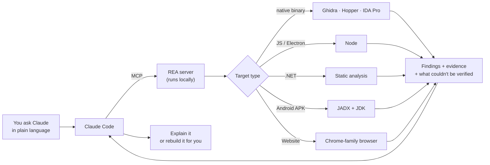
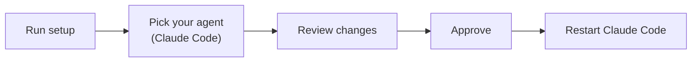
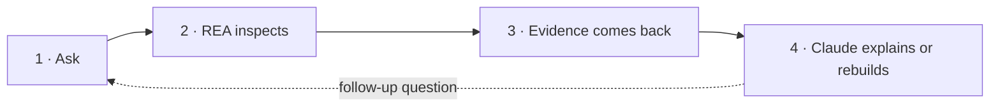

# REA (Reverse Engineer Anything): Claude setup pack

**What it is:** an MCP server that connects reverse-engineering tools (Ghidra, Hopper, IDA Pro) to Claude Code. You point Claude at an app, no source code needed. It inspects the binary, shows its evidence, and can rebuild the feature for your own project.

- **Repo:** https://github.com/morluto/rea
- **Site:** https://rea.tools
- **License:** MIT



## 1. Install (about 2 minutes)

Requires **Node.js 22.19+, 24.x, or 26+** (`node --version` to check).

```bash
npx rea-agents setup
```



Setup does two things at once: it registers the **MCP server** and installs the matching **workflow skill** for Claude.

**For regular terminal use:**

```bash
npm install --global rea-agents
rea --help
```

**Keep it updated** (it ships fast):

```bash
rea update
npx rea-agents@latest setup   # re-run after updating
```

## 2. What you need for what

| Target | Needs | Extra install? |
|---|---|---|
| Native binaries (`.exe`, `.dylib`, `.so`) | Ghidra (free), Hopper, or IDA Pro. Setup can install Hopper for you | 🟡 Yes |
| JavaScript / Electron apps | Node only | 🟢 No |
| .NET assemblies | Nothing (static analysis only) | 🟢 No |
| Android APKs | Headless JADX + a full JDK | 🟡 Yes |
| Websites | A Chrome-family browser | 🟢 Usually already have it |

You only need a disassembler for native binaries.

## 3. How to use it

Ask Claude in plain language. Example from the official README:

> "Understand how search works in the Notes app, show me the evidence, and build a similar feature for my project."



Each finding comes with its evidence and a note on what REA couldn't verify.

**Terminal one-liner for JS/Electron apps:**

```bash
npx -y rea-agents@latest analyze-javascript-application /absolute/path/to/app --json
```

## 4. Caveats

| | Caveat | What it means for you |
|---|---|---|
| ⚖️ | **Lawful use only** | The project's disclaimer limits it to researching, learning, and analyzing software you own or have permission to examine. Rebuilding a feature you like for your own product is fine. Cloning someone's app to sell it: talk to a lawyer first, because laws vary. |
| 🔒 | **Local analysis, cloud reasoning** | Your binaries stay on your machine. Whatever Claude reads goes to the model provider, so their data policy covers the findings. |
| 🐢 | **First Ghidra query is slow** | Up to ~5 minutes while it imports and auto-analyzes a large binary. Later queries are normal speed. |

## Why it took off

It isn't a demo. It puts the whole RE toolchain behind one MCP interface that installs with one command. That turns things that used to take an expert, like restoring removed game features or building a custom app for a smart appliance, into a prompt. (Source: a reel by @peter.zezas.)
